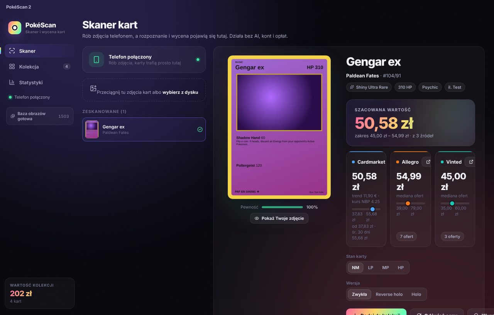
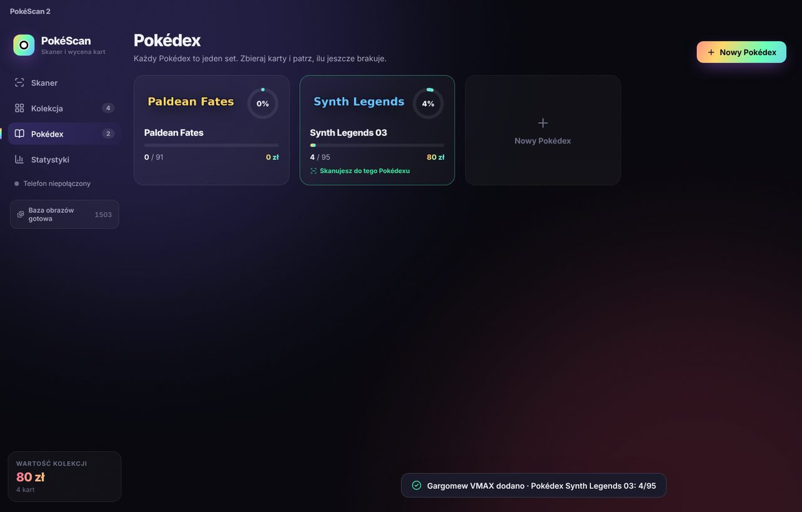
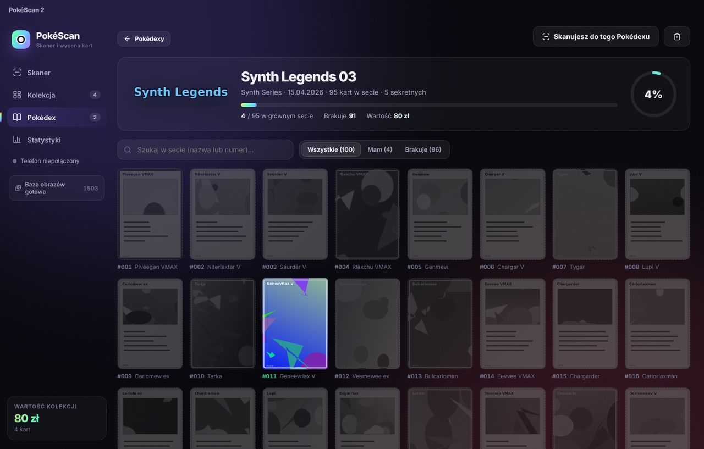
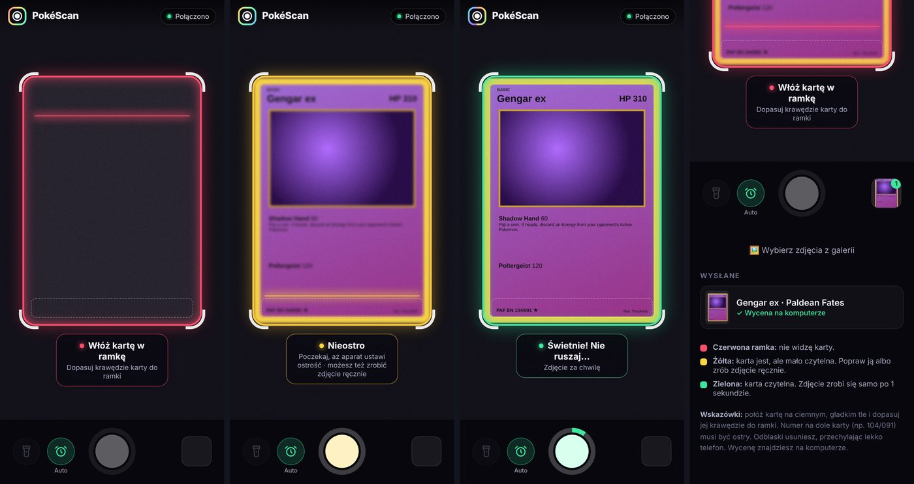

# PokéScan 2

Darmowy skaner i wyceniarka kart **Pokémon TCG** na Windows. Telefon służy jako skaner, a komputer rozpoznaje kartę, sprawdza jej cenę na Cardmarket, Allegro i Vinted i prowadzi Twoją kolekcję oraz Pokédexy setów.

Nie potrzebuje AI, kont, kluczy API ani opłat. Rozpoznawanie działa na Twoim komputerze.

> **English:** free Pokémon TCG card scanner for Windows. Your phone is the camera (live frame with auto-capture), the PC recognises the card offline (OpenCV + image fingerprints + Tesseract OCR, no AI, no API keys), prices it from Cardmarket (via TCGdex), Allegro and Vinted, and tracks your collection and per-set Pokédex completion. Download the installer from [Releases](../../releases). The UI is in Polish.



## Co potrafi

- **Telefon jako skaner.** Zeskanuj kod QR i na telefonie otworzy się aparat z ramką w kształcie karty:
  - czerwona ramka: nie widać karty,
  - żółta: karta jest, ale mało czytelna (można zrobić zdjęcie ręcznie),
  - zielona: karta czytelna i zdjęcie robi się od razu samo.
- **Rozpoznawanie bez AI.** Zdjęcie jest porównywane z „odciskami” obrazków wszystkich kart z darmowej bazy [TCGdex](https://tcgdex.dev). Działa nawet dla kart pełnoobrazkowych, w koszulkach i z odblaskami. OCR (Tesseract) odczytuje numer i nazwę i potwierdza wynik.
- **Wycena z trzech źródeł.** Cardmarket (przez TCGdex, przeliczone na zł po kursie NBP), Allegro i Vinted (mediana ofert). Uwzględnia stan karty (NM, LP, MP, HP).
- **Kolekcja i statystyki.** Wartość kolekcji, najcenniejsze karty, wartość według setów.
- **Pokédex.** Jeden Pokédex to jeden set, np. najnowszy dodatek. Tworzy się sam przy pierwszej karcie z setu. Widzisz wszystkie karty setu: te, które masz, i te, których brakuje, postęp w procentach i wartość. Skanując „do Pokédexu”, aplikacja szuka tylko wśród kart tego setu, więc rozpoznaje jeszcze pewniej.

| Pokédexy | Karty setu | Telefon |
| --- | --- | --- |
|  |  |  |

## Instalacja (Windows 10 i 11)

1. Wejdź w zakładkę **[Releases](../../releases)** po prawej stronie repozytorium i pobierz najnowszy plik **`PokeScan2-Setup-x.y.z.exe`**. Wersja bez instalacji to `PokeScan2-x.y.z-win-x64.zip`: rozpakuj ją i uruchom `PokeScan 2.exe`.
2. Uruchom instalator. Windows może pokazać „System Windows ochronił komputer”, bo aplikacja nie ma płatnego podpisu cyfrowego. Kliknij **Więcej informacji → Uruchom mimo to**.
3. Przy pierwszym uruchomieniu Zapora Windows zapyta o dostęp do sieci. Zaznacz **Sieci prywatne** i kliknij **Zezwalaj**. Bez tego telefon nie połączy się z komputerem.
4. Poczekaj, aż w lewym panelu „Pobieram bazę obrazów” zmieni się na „Baza obrazów gotowa”. Aplikacja pobiera wtedy jednorazowo małe obrazki wszystkich kart (ok. 20 tys., kilkaset MB, zwykle kilka minut). Później dociąga tylko nowe karty.

## Konfiguracja telefonu

1. Telefon i komputer muszą być w **tej samej sieci Wi‑Fi**.
2. W aplikacji na komputerze otwórz **Skaner** i zeskanuj kod QR aparatem telefonu, a potem stuknij link.
3. Telefon ostrzeże, że połączenie nie jest prywatne. To normalne: strona działa tylko w Twojej sieci domowej i używa własnego certyfikatu, bo przeglądarki pozwalają na aparat na żywo tylko przez https.
   - **Android (Chrome):** Zaawansowane → Przejdź do strony.
   - **iPhone (Safari):** Pokaż szczegóły → odwiedź tę witrynę → Odwiedź witrynę.
4. Zezwól stronie na użycie aparatu.

Jeśli aparat na żywo nie zadziała, strona sama przełączy się na zwykłe zdjęcia. Pod kodem QR jest też adres bez https.

### Android

- Strona sama wybiera główny tylny aparat (nie szerokokątny ani makro), bo tylko on dobrze łapie ostrość z bliska. Jeśli obraz jest nieostry, stuknij przycisk aparatu u góry (np. „1/3”), aby przełączyć obiektyw. Wybór zostaje zapamiętany.
- **Stuknij podgląd**, żeby ustawić ostrość w danym miejscu (jeśli telefon na to pozwala).
- Przycisk **pełnego ekranu** u góry chowa pasek adresu i zostawia więcej miejsca na kartę.
- W Chrome stuknij **⋮ → Dodaj do ekranu głównego**. Skaner otworzysz wtedy ikoną jak zwykłą aplikację, bez paska przeglądarki. Link i ikona działają także po ponownym uruchomieniu programu na komputerze (o ile komputer ma ten sam adres w sieci).
- Jeśli wcześniej nie zezwolono na aparat: stuknij ikonę obok adresu strony → **Uprawnienia → Aparat → Zezwól** i odśwież stronę.

## Jak skanować

- Połóż kartę na ciemnym, gładkim tle i dopasuj jej krawędzie do ramki. Gdy ramka zaświeci na zielono, zdjęcie zrobi się samo.
- Po zdjęciu zabierz kartę i połóż następną. Kolejne zdjęcie zrobi się dopiero dla nowej karty.
- Przycisk **Auto** wyłącza zdjęcia automatyczne, a **Latarka** włącza lampę (jeśli telefon na to pozwala).
- Zdjęcia możesz też przeciągnąć z dysku do okna aplikacji.
- Przy wyniku widać **Pewność**. Gdy jest niska, porównaj kartę ze zdjęciem i w razie potrzeby wybierz właściwą z listy „Nie ta karta?” albo z wyszukiwarki.

## Pokédex

Pokédex tworzy się sam, gdy dodasz do kolekcji pierwszą kartę z danego setu. Możesz też dodać go ręcznie: **Pokédex → Nowy Pokédex** i wybierz set (najnowsze są na górze, można szukać po nazwie).

- Licznik pokazuje, ile kart setu masz ze wszystkich (np. 3 / 120). Osobno widać główny set (karty z numerem do liczby kart w secie, np. 84) i karty sekretne (np. 085/084 i wyżej).
- Filtry **Mam** i **Brakuje** pokazują posiadane i brakujące karty. Brakującą kartę możesz kliknąć i dodać ręcznie.
- **Skanuj do tego Pokédexu**: skaner szuka tylko wśród kart tego setu, więc rozpoznaje jeszcze pewniej. Zmienisz to w polu „Skanuję do:” na ekranie skanera.

## Dane i ustawienia

Wszystko jest zapisane na Twoim komputerze w `%APPDATA%\PokeScan 2\`:

| Plik | Zawartość |
| --- | --- |
| `collection.json` | Twoja kolekcja |
| `pokedex.json` | Twoje Pokédexy |
| `visual-index.json`, `visual-index.bin` | baza odcisków obrazów (możesz usunąć, zbuduje się ponownie) |
| `https-cert.json` | certyfikat strony dla telefonu |
| `phone-token.txt` | kod parowania telefonu (usuń, aby unieważnić stare linki i ikony na telefonach) |
| `pokescan.log` | dziennik, przydatny przy zgłaszaniu problemów |

Zaawansowane ustawienia (zmienne środowiskowe, zwykle niepotrzebne):

| Zmienna | Domyślnie | Znaczenie |
| --- | --- | --- |
| `POKESCAN_PORT` | `8766` | port aplikacji (http) |
| `POKESCAN_HTTPS_PORT` | port + 1 (`8767`) | port strony dla telefonu (https) |
| `TCGDEX_API` | `https://api.tcgdex.net/v2/en` | adres bazy kart |

Prywatność: zdjęcia nie opuszczają Twojego komputera. Aplikacja łączy się tylko z TCGdex (dane i obrazki kart, ceny Cardmarket), NBP (kurs euro) oraz Allegro i Vinted (oferty, w ukrytym oknie przeglądarki).

## Rozwiązywanie problemów

- **Telefon nie łączy się:** sprawdź, czy oba urządzenia są w tej samej sieci Wi‑Fi (nie w sieci dla gości) i czy Zapora Windows pozwala aplikacji na sieci prywatne.
- **Ramka nie robi się zielona:** zapal światło, usuń odblaski (lekko przechyl telefon), wyjmij kartę z grubego toploadera albo zrób zdjęcie ręcznie przy żółtej ramce.
- **Zła karta:** wybierz właściwą z listy podobnych. Skanowanie do Pokédexu bardzo poprawia trafność.
- **Allegro lub Vinted prosi o weryfikację:** okno przeglądarki pokaże się samo. Rozwiąż ją, a aplikacja dokończy odczyt cen.
- Zgłaszając błąd w zakładce **Issues**, dołącz plik `pokescan.log`.

## Budowanie ze źródeł

Wymagany [Node.js](https://nodejs.org) 20 lub nowszy.

```bash
npm ci
npm start            # buduje i uruchamia aplikację
npm run dist:win     # instalator i zip w folderze release/
```

Bez Electrona można uruchomić sam serwer (`npm run server`) i otworzyć `http://localhost:8766` w przeglądarce. Ceny z Allegro i Vinted działają tylko w aplikacji.

Wydanie nowej wersji: zmień `version` w `package.json` i opublikuj Release na GitHubie z tagiem np. `v2.6.0`. GitHub Actions (`.github/workflows/build-windows.yml`) zbuduje instalator na Windows i doda go do wydania.

### Jak to działa

| Element | Technologia |
| --- | --- |
| Aplikacja | Electron, React, Vite |
| Strona telefonu | jeden plik HTML, aparat przez `getUserMedia`, wykrywanie krawędzi karty w JavaScript |
| Wyszukanie i wyprostowanie karty | OpenCV.js |
| Rozpoznanie | odciski obrazków (siatka jasności 16×22 + kolory 8×11) porównywane z całą bazą TCGdex, do tego pHash |
| Odczyt tekstu | Tesseract.js (offline) |
| Ceny | TCGdex (Cardmarket), NBP, Allegro i Vinted w ukrytym oknie przeglądarki |

## Licencja i zastrzeżenia

Kod jest na licencji [MIT](LICENSE).

PokéScan nie jest związany z The Pokémon Company, Nintendo, Creatures, GAME FREAK, Cardmarket, Allegro ani Vinted. Pokémon i nazwy postaci są znakami towarowymi ich właścicieli. Dane i obrazki kart pochodzą z bazy [TCGdex](https://tcgdex.dev) i są pobierane na komputer użytkownika, a nie przechowywane w tym repozytorium.
